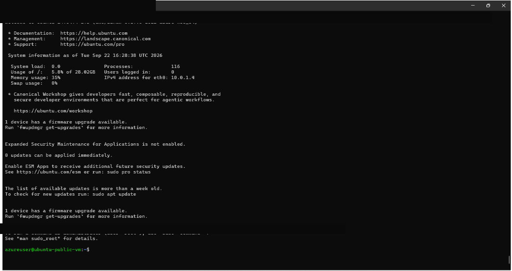

# Azure Virtual Network and SSH Lab

**Platform Technology Activity | September 2026**

## About This Activity

For this school activity, I practiced setting up an Azure virtual network and connecting to a Linux virtual machine. It was a bit confusing at first, especially the networking part, but I was able to complete the SSH connection.

## What I Worked On

- Created an Azure resource group and virtual network.
- Added two subnets labeled public and private for the activity.
- Created route tables and associated them with the subnets.
- Added a `0.0.0.0/0` route with an Internet next hop to the public route table.
- Deployed an Ubuntu VM and connected to it from PowerShell using SSH and a private key.

## Tools I Used

Microsoft Azure, Virtual Network, Subnets, Route Tables, Ubuntu VM, PowerShell and SSH.

## Output

The screenshot shows the Ubuntu terminal after my SSH connection succeeded. I did not separately test whether the two subnets were isolated from one another.

## What I Learned

I learned how cloud networking resources fit together and how to configure a network and connect it to a VM. I still have a lot to learn about routes and network security, but this helped me understand them better.

**Note:** This was an academic activity using temporary Azure resources. The VM is no longer running. I did not upload the SSH private key or the original screenshots containing account details.
